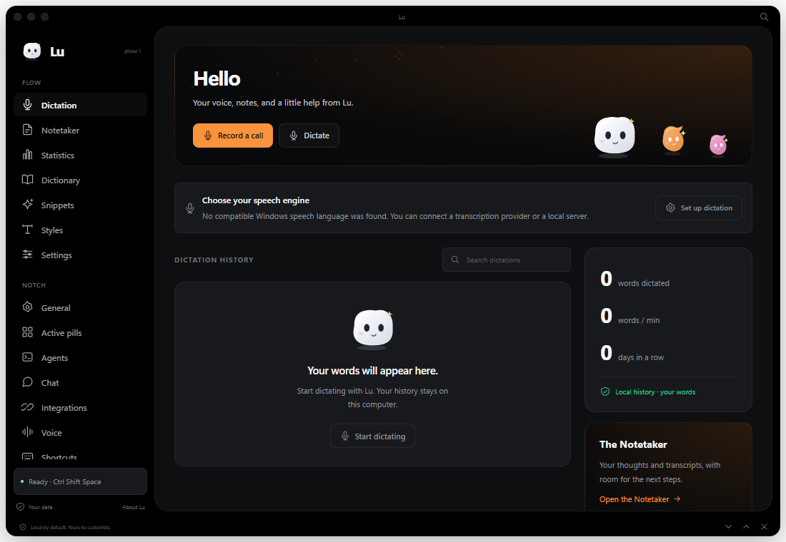

# lu.

A little presence. A little possibility.

Lu is a customizable companion built around Coucou's island and Flow / Notch workflow, with an original Lu character. The small island shows the time, buddy, and colored pills. Click it for a quick panel; open the full workspace when you want more room.



## Open Lu

For a local packaged build, open **`Start Lu.cmd`** or **`release/Lu-win32-x64/Lu.exe`**. Keep the whole release folder together. No installer or account is needed for local features. This repository contains source; generated portable builds are excluded. From a fresh checkout, follow **Develop** below to build and run Lu.

- Drag the small dotted grip to move Lu.
- Click the buddy or clock to open the quick panel or return to the island.
- Use the expand icon for the full Flow / Notch workspace.
- Right-click the buddy to open its wardrobe and appearance settings.
- `Ctrl Shift Space` shows or minimizes Lu. The tray menu can always bring it back.
- `Ctrl K` jumps to a screen or note. `Esc` returns to the island.
- Closing the workspace hides Lu in the tray. Choose **Quit Lu** in the tray menu to exit.

## Your little workspace

**The quick panel** follows Coucou's compact overview: Lu on the left, colored shortcuts on the right, and a quick chat field. You can also dictate, capture a quick note, and control a focus timer here.

**Flow** includes Dictation, Notetaker, Statistics, Dictionary, Snippets, Styles, and dictation Settings. Statistics uses actual saved dictations: words, pace, and consecutive days. History retention is configurable.

**Notch** includes General, Active pills, Agents, Chat, Integrations, Voice, and Shortcuts. Appearance, Focus, and AI providers are also directly accessible. The OLED palette, sidebar grouping, and right-hand panel follow Coucou's open-source hub.

**Chat** connects to your choice of Ollama, OpenAI, Anthropic, Gemini, Groq, or a compatible local server such as LM Studio. Conversations are saved locally. Responses stream as they arrive; you can stop, copy, save a response as a note, attach a small text document, or export a conversation.

**Notetaker** is a local notebook with search, pinning, automatic saving, meeting notes, and Markdown export. Use a transcript in Chat to request a summary, decisions, and action items. Deleted notes have a short undo window.

**Dictation** captures your microphone only after you press record. Choose Windows' installed offline recognizer, or an OpenAI-compatible transcription service. Edit, copy, save, or use the transcript in Chat. Your dictionary replaces personal words and names; snippets expand short phrases into longer text. Styles can keep the words as spoken or clean punctuation locally. API audio is discarded from memory after transcription unless you turn on the option to save it.

**Focus** has real focus and break timers, pause, reset, custom durations, and a local history of completed focus sessions. An active timer remains visible on the island. Quiet mode keeps completion notices inside Lu.

**Agents** connects to local Claude Code and Codex sessions through their hooks. See current tool activity, permission requests, and pending Claude questions. Lu can return an explicit one-time permission decision or your question answer. Requests appear in the quick panel and leave an indicator on the island. Sessions and request details stay in memory. The bridge and Windows relay pass isolated tests; a live, user-connected Claude or Codex session has not yet been verified.

**Personalization** includes themes, accents, a soft Lu or comet character, outfits, individual pill colors, clock format, position, and up to three island shortcuts. Motion can be reduced. Voice can read chat replies with an installed local speaking voice; quiet mode disables automatic speech.

## Give Lu a voice

1. Open **AI providers** in the workspace sidebar.
2. Choose your provider. For a cloud provider, paste and save your API key. For Ollama, start the local server and install a model separately.
3. Load the model list or enter the exact model ID. Select **Use provider**.
4. Open Chat and send a thought.

Keys are encrypted using Windows' credential protection in the desktop process. Saved keys are never sent to the interface or included in a Lu backup. A provider connection is only checked when you press **Load models** or send a message. Each provider controls its own availability, quotas, model support, and pricing.

For API dictation, choose **Flow → Settings → Transcription service**, then select the provider and model. Save that provider's key in AI providers. A local Parakeet server can be used if it exposes an OpenAI-compatible `/v1/audio/transcriptions` endpoint; Lu does not download or bundle Parakeet models. This computer currently has no compatible Windows offline recognizer installed.

## Your data

The packaged app stores notes, chats, preferences, and encrypted credentials in Windows' application data folder under **Lu**. Development runs use **`.lu-data/`** in this project. Tests use separate temporary workspaces under **`.lu-test-data/`**.

Backups contain notes, chats, preferences, dictionary entries, snippets, dictation history, and completed focus sessions. Import merges notes, chats, dictionary entries, snippets, and eligible dictation history by ID, keeping existing entries on conflict. It keeps the current preferences and focus history. API keys are always excluded. There is no background cloud sync or telemetry.

Text files are read when you explicitly attach them. Agent setup reads its target settings file to preserve existing configuration; connected hooks send event details to Lu over authenticated localhost. Lu does not scan project files or agent transcripts. A chat attachment goes to the provider together with your message. Microphone audio goes to the selected API only when you finish an API recording. Windows speech stays on this computer. System audio capture, speaker separation, dictation insertion into other apps, a Lu-managed agent runtime, and cloud sync are future work.

## Connect a coding agent

1. Open **Notch → Agents** in the desktop app and choose **Set up Claude Code** or **Set up Codex**.
2. Review the hooks and settings-file location, then press **Connect**. Lu backs up the existing file and merges its hooks alongside other tools' hooks. This also enables Lu's local connection.
3. Start a new local agent session. For Codex, review and trust Lu's hooks through **`/hooks`** before they can run.
4. When a request arrives, review the full details in Lu and choose **Allow once**, **Decline**, or **Answer in agent**. For a Claude question, choose an option or write an answer and send it.

No extra API key is needed for the hook connection. Recent agent versions are required. Codex questions without a supported hook stay in Codex. Hooks do not provide a complete transcript, and cloud-orchestrated sessions are outside this connection's scope. Requests expire after about two minutes; on timeout, disconnect, or fallback Lu emits no permission decision. The agent then follows its own normal flow. Lu has no remembered automatic approvals.

**Pause connections** stops the local bridge. **Disconnect** removes Lu's own hooks while preserving other settings. Setup changes occur only when you press Connect or Disconnect. See [verification notes](docs/VERIFICATION.md) and the [official Codex](https://learn.chatgpt.com/docs/hooks) and [Claude](https://code.claude.com/docs/en/hooks) hook documentation.

## Develop

Requires Node.js 22.12+ and pnpm. Clone the repository and install dependencies:

```sh
git clone https://github.com/alexwithadog/lu.git
cd lu
pnpm install
```

Then:

```sh
pnpm build
pnpm start
pnpm check
pnpm test
pnpm package
```

For development with a live frontend, run `pnpm dev` and launch Lu with `LU_DEV_URL=http://127.0.0.1:1420`. Set `LU_DATA_DIR` to an absolute path for an isolated workspace. The browser preview works for local UI features; keys, native dictation, and cloud requests are available in the desktop app.

The frontend uses vanilla TypeScript, CSS, and small inline SVGs. There is no UI framework or production JavaScript dependency. Electron provides the native shell, tray, shortcuts, dialogs, credential protection, and provider requests. Windows speech and agent relay helpers compile with the .NET Framework on Windows. API dictation remains available without the speech helper; agent connections and portable packaging require the relay helper. The application can later host the same frontend in Tauri.

`tests/ui.cjs` runs optional headless frontend checks using Playwright and a fresh browser profile. Set `LU_PLAYWRIGHT_PATH` and `LU_CHROME_PATH` if those tools are supplied externally. It never attaches to a personal browser or the Windows desktop.

Research notes are in **`research/`**. The separate upstream Coucou checkout stays local and is excluded from this repository and the app. Recreate that optional reference with `git clone https://github.com/Louis-CFM/coucou.git coucou`. See [third-party notices](THIRD_PARTY_NOTICES.md).
