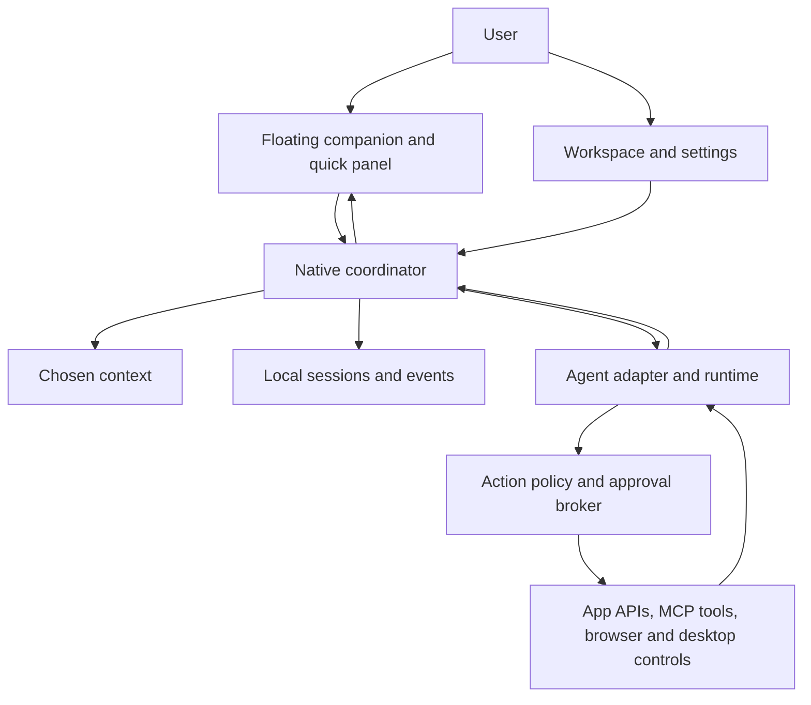

# Desktop companion research — findings and recommendation

Research date: October 14, 2026. Research resumed and synthesis completed after the user's instruction to continue. MacPy is excluded.

Scope: source inspection, primary documentation, published screenshots and website demos. No native app was installed or benchmarked. Coucou is cloned locally at `1456bd3c87f91d6e267516203c84b0148b587120`, and the upstream checkout remains unchanged. This is a research foundation for a personalized product; it is not a full security audit or a finalized product specification.

The strongest direction for the future app is a quiet desktop companion with a small floating surface, a larger workspace for complex tasks, and a separate execution service. Appearance, attention, model choice, context capture, and permission to act are distinct design problems. These recommendations are my synthesis; the sources below establish the observed implementations.

## What each reference contributes

| Reference | Main role | Useful lesson for this project |
|---|---|---|
| [Coucou](https://github.com/Louis-CFM/coucou) | Ambient companion, agent monitoring, approvals, chat, integrations | Small presence that expands when attention is needed; character animation communicates activity |
| [CC Switch](https://github.com/farion1231/cc-switch) | Configuration, providers, routing, sessions, usage, extensions | A separate management window keeps complex configuration out of the floating UI |
| [Open Dots](https://github.com/Anil-matcha/open-dots) | Coding tasks through web/Telegram, permissions, scheduling | Keep tasks and permission records outside the presentation layer |
| [Open Interpreter](https://github.com/openinterpreter/openinterpreter) | Agent execution runtime | Reuse a runtime through a defined protocol instead of building model execution into the mascot |
| [Tauri](https://v2.tauri.app/) | Desktop/mobile application framework | Web UI with a Rust native boundary, system WebViews, tray integration and packaging |

### Coucou: closest product reference

The cloned source is substantially newer than the cached search README. It has a native SwiftUI/AppKit Mac app, a Tauri 2 Windows/Linux app, phone components, multiple agents, and a detachable desktop companion. Platform feature parity must be checked individually. The Windows frontend is plain TypeScript with Vite and Canvas 2D, not React. [Source configuration](https://github.com/Louis-CFM/coucou/blob/1456bd3c87f91d6e267516203c84b0148b587120/windows/package.json).

The visual design uses a black screen-edge island, dark rounded cards, restrained chrome, colored agent pills, a dominant character and progressive disclosure. Published screenshots show an action timeline beside file diffs, and a compact chat composer. The character is drawn procedurally: motion and expression are tied to state, rather than requiring an AI call for every animation.

The interaction system separates hidden, compact, expanded and greeting states. Waiting alerts are pinned, so auto-close does not discard a permission request. The Windows state machine's current defaults differ from some older design-spec timing descriptions. Read code before copying timers. [State machine](https://github.com/Louis-CFM/coucou/blob/1456bd3c87f91d6e267516203c84b0148b587120/windows/src/island/fsm.ts).

The Windows overlay is transparent, undecorated, always on top and absent from the taskbar. Native flags prevent passive clicks from activating it; typing deliberately enables activation. A cursor loop toggles click-through around the island, handles file dragging separately, and parks when inactive. Monitor changes and DPI conversion are explicit concerns. These mechanisms are more consequential than the rounded-card styling. [Window handling](https://github.com/Louis-CFM/coucou/blob/1456bd3c87f91d6e267516203c84b0148b587120/windows/src-tauri/src/platform/windows.rs), [island implementation](https://github.com/Louis-CFM/coucou/blob/1456bd3c87f91d6e267516203c84b0148b587120/windows/src-tauri/src/island.rs).

Agent events enter through a short-lived relay: stdin JSON → event normalization → per-user named pipe on Windows or Unix socket on Linux → backend → UI. Approvals return through the same connection. The relay has a 300 ms connection budget, a 2 s ordinary-event budget and a 110 s decision budget. The backend first requires acknowledgement that a card is visible; missing UI acknowledgement avoids leaving an agent waiting for an invisible prompt. A timeout hands decision-making back to the agent's normal interface; it does not mean permission was granted. Current approval support varies by agent. [Relay](https://github.com/Louis-CFM/coucou/blob/1456bd3c87f91d6e267516203c84b0148b587120/windows/hook/src/main.rs), [pipe server](https://github.com/Louis-CFM/coucou/blob/1456bd3c87f91d6e267516203c84b0148b587120/windows/src-tauri/src/pipe.rs), [reply formats](https://github.com/Louis-CFM/coucou/blob/1456bd3c87f91d6e267516203c84b0148b587120/windows/hook/src/reply.rs).

Coucou's Mac window-context attachment reads application name, window title and optional browser URL. That is not equivalent to understanding the full screenshot or reading the entire window. Windows does not offer the same window-attachment workflow in the inspected README. Chat providers also differ in file, vision, search and tool capabilities. [Mac context capture](https://github.com/Louis-CFM/coucou/blob/1456bd3c87f91d6e267516203c84b0148b587120/NotchBuddy/Sources/App/WindowContextCapture.swift), [Windows differences](https://github.com/Louis-CFM/coucou/blob/1456bd3c87f91d6e267516203c84b0148b587120/windows/README.md).

Dropped-file access is constrained to paths received from an actual OS drop, valid briefly and consumed once. Keys are handled by the native credential store rather than exposed to the renderer. These are useful boundaries for our own app. [Files](https://github.com/Louis-CFM/coucou/blob/1456bd3c87f91d6e267516203c84b0148b587120/windows/src-tauri/src/files.rs), [secrets](https://github.com/Louis-CFM/coucou/blob/1456bd3c87f91d6e267516203c84b0148b587120/windows/src-tauri/src/secrets.rs).

Coucou's code is MIT, but its name, Mochi character, icon, sounds and media have separate restrictions. A distributed personalized derivative needs its own identity and assets. This is an explicit upstream asset-license condition. [Asset license](https://github.com/Louis-CFM/coucou/blob/1456bd3c87f91d6e267516203c84b0148b587120/LICENSE-ASSETS.md).

### CC Switch: management reference

The inspected version identifies itself as 4.0.12 and uses Tauri 2, React, TypeScript and Rust. Its published desktop screenshot shows a sidebar, provider rows, quotas and a clear selected-provider indicator. Direct, Routing and Aggregation tabs separate viewing a mode from actually activating it. The manual says clicking a tab does not change configuration; a separate action states the consequence. This is a good pattern for settings that affect other apps. [Interface manual](https://github.com/farion1231/cc-switch/blob/51ac86f1c59abfefabadebd05ec5a5415b8ad72c/docs/user-manual/en/1-getting-started/1.3-interface.md).

Its session browser groups history by time or project, offers conversation/changes views and exports Markdown. Resume behavior differs by OS and tool; a visible resume button is not proof of universal native session control. [Session manual](https://github.com/farion1231/cc-switch/blob/51ac86f1c59abfefabadebd05ec5a5415b8ad72c/docs/user-manual/en/3-extensions/3.4-sessions.md).

Local routing can convert API formats, switch subsequent requests to another provider and maintain failover queues. It also introduces a service that clients depend on while routed. Protocol conversion should not be assumed to preserve every model feature. Our initial companion does not need to reproduce this entire subsystem. [Routing manual](https://github.com/farion1231/cc-switch/blob/51ac86f1c59abfefabadebd05ec5a5415b8ad72c/docs/user-manual/en/4-proxy/4.1-service.md).

### Open Dots: task and approval reference

The current project is a prototype with a Next.js frontend, FastAPI backend and PostgreSQL, plus experimental SQLite/local execution. Web and Telegram clients share services. Its principal remote workflow runs Claude Code in Boat sandboxes, supports GitHub connection, human permission decisions and recurring prompts. It is not currently a floating native desktop companion. [Current README](https://github.com/Anil-matcha/open-dots/blob/9f2b473599865c0e42050ee681018f9134b26c7e/README.md).

The permission service checks the most specific matching rule and returns ask when none exists. The Git classifier distinguishes some read, local mutation and publish operations; it is a limited classifier, not a complete shell security boundary. The local-run policy checks loopback, Host and Origin and refuses forwarding headers. [Permission service](https://github.com/Anil-matcha/open-dots/blob/9f2b473599865c0e42050ee681018f9134b26c7e/backend/app/services/permission_service.py), [classifier](https://github.com/Anil-matcha/open-dots/blob/9f2b473599865c0e42050ee681018f9134b26c7e/backend/app/services/github_classifier.py), [local policy](https://github.com/Anil-matcha/open-dots/blob/9f2b473599865c0e42050ee681018f9134b26c7e/backend/app/services/local_access_policy.py).

Its architecture document proposes provider adapters, durable threads/turns/events, an approval broker and replayable streams, and explicitly marks this as target direction. Current local text streaming is memory-only. These distinctions are valuable: scheduling, reconnection and durable conversation identity need deliberate implementation. The README also discloses missing web owner authentication. [Architecture](https://github.com/Anil-matcha/open-dots/blob/9f2b473599865c0e42050ee681018f9134b26c7e/docs/ARCHITECTURE.md).

The repository advertises MIT licensing, but no root LICENSE file appeared in the inspected recursive tree. Verify an actual grant before proposing source reuse.

### Open Interpreter: distinguish current and classic versions

The current official repository redirects to openinterpreter/openinterpreter and contains a Rust runtime based on Codex, with harness selection, MCP, permissions, hooks and ACP compatibility. The original Python project is now a community-maintained fork. Interpreter Workstation is a separate desktop/browser workspace, implemented with Electron, which uses the runtime rather than duplicating its provider implementation. Research based solely on old Python tutorials would describe a different architecture. [Current runtime](https://github.com/openinterpreter/openinterpreter/blob/ac1fcc8fe57aba51fcc3c79afd57a0883237fe87/README.md), [classic Python fork](https://github.com/endolith/open-interpreter), [Workstation](https://github.com/openinterpreter/interpreter-workstation).

## Other references worth retaining

| Reference | What was reviewed | Useful pattern |
|---|---|---|
| [Notchi](https://github.com/sk-ruban/notchi) | README, official site, documented socket/state/sprite workflow | Per-session animated characters, optional emotions, usage visibility; optional sentiment analysis sends prompts to a provider |
| [notch-911](https://github.com/ARITRA69/notch-911) | Detailed README and architecture description | Separate hover and interaction surfaces; fixed native panel with animated content; explicit prompt types and focus behavior |
| [Boring Notch](https://github.com/TheBoredTeam/boring.notch) | Primary README | Music, calendar and file shelf make an ambient surface useful outside coding; verify roadmap versus shipped functions |
| [CatDesk](https://github.com/AlexisBERT-Work/ai-desktop-copilot) | README and architecture | Windows overlay, local Ollama, Rust boundary, separate agent/OCR sidecars and tool schemas; local inference still has hardware and network-feature tradeoffs |
| [BongoCat](https://github.com/ayangweb/BongoCat) | README and current Cargo workspace | Custom models, pointer/input reactions and draggable character; current source has native Rust architecture despite older Tauri tags |
| [Pot](https://github.com/pot-app/pot-desktop/blob/main/README_EN.md) | English README | Select text or screen region → shortcut → immediate contextual result; native/offline OCR and provider/plugin options |
| [Pake](https://github.com/tw93/Pake) | Primary README | Packaging a website is useful for quick desktop access, but does not itself supply an agent runtime or desktop context |
| [Raycast AI](https://www.raycast.com/core-features/ai) | Official product page | Keyboard invocation, reusable commands, project context, screen awareness and extensions; product features are documented claims, not independently tested here |
| [Jan](https://github.com/janhq/jan) | Current README, Cargo manifest, license and official site | Tauri-based workspace with local/cloud providers, custom assistants and MCP; useful for model setup and local inference UX |
| [Interpreter Workstation overlay](https://github.com/openinterpreter/interpreter-workstation/tree/62ff0a3982f92ba00a56649cfa0ced80658022ac/apps/interpreter-overlay) | Overlay README, window implementation, IPC context types, approval dashboard, target identity and hit-testing modules | Stronger reference for desktop actions: selected targets, accessibility elements, action previews and an execution/review boundary |

## Proposed architecture to explore with the user

This is a recommendation, not an approved product specification.

```text
Small companion / floating panel     Larger workspace and settings
                  \                   /
                   Typed native command/event boundary
                                  |
                   Session, task and attention coordinator
                     /          |             \
              Agent adapters  Approval broker  Local event/history store
                    |               |                  |
             Existing runtimes   Scoped tools      Preferences/context
                     \              /
                      OS and app integrations
```

For a Windows-first app, Tauri 2 plus a TypeScript UI and Rust system layer is a strong starting candidate. React is useful if the workspace becomes complex; it is not required for a small overlay. A Node or Python sidecar should have a concrete purpose, such as an existing runtime or document/OCR libraries. SwiftUI/AppKit is attractive if native Mac notch behavior becomes the priority. Electron is also viable when its tooling or an existing runtime host materially reduces work. These are tradeoffs to validate, not universal performance claims. [Tauri architecture](https://github.com/tauri-apps/tauri), [configuration](https://v2.tauri.app/reference/config/), [capabilities](https://v2.tauri.app/security/capabilities/), [Electron security](https://www.electronjs.org/docs/latest/tutorial/security).

The first implementation should prove overlay behavior: click-through, typing/focus return, dragging, monitor/DPI changes, keyboard access, reduced motion and idle resource use. Then add one agent adapter with visible state and a correctly correlated approval flow. Context should be explicit and removable: file, selected text, screen region, window metadata or project. A larger workspace should carry history, settings and long outputs.

Later stages can add app tools, voice, schedules and optional phone control. Every added integration should declare what it can read or change and report partial failures. Stopping a running task and recovering after a restart are separate features; neither follows automatically from a chat box or an always-on-top window.

Personalization remains open: character or minimal orb/pill, placement, colors and motion, top daily workflows, model providers, local/cloud preference, memory behavior, and which actions may proceed under standing rules. The research supports making these choices with the user; it does not establish those preferences for them.

## The product has five separate responsibilities

| Responsibility | What it does | Closest reference |
|---|---|---|
| Presence | Position, character, animation, hover, click-through, keyboard invocation | Coucou, Notchi, BongoCat |
| Attention | Prioritize waiting work, questions, errors and completed tasks without interrupting every action | Coucou, notch-911 |
| Context | Attach an explicitly chosen file, selection, app window, browser document or screen region | Pot, Workstation overlay |
| Execution | Run a task, call tools, stream output, cancel, and record the outcome | Open Interpreter, Open Dots |
| Management | Configure providers, integrations, projects, history, permissions and optional schedules | CC Switch, Jan |

Keeping these responsibilities separate lets us redesign the character and placement without rewriting the agent runtime. It also allows a calm companion mode when no active task needs attention.



The diagram is a proposed architecture, not a diagram of any single reference app.

## What a good floating UI must get right

The appeal comes from a small set of consistent behaviors, not the number of features squeezed into the island.

1. **Stay available without taking over.** Use a compact anchor or character, a global shortcut and a reliable way back from the tray. Opening settings should not be required for ordinary assistance.
2. **Expand with a purpose.** A task can appear as a badge; a question needs a readable panel; a long conversation belongs in the workspace. The panel should communicate why it opened.
3. **Distinguish hover from typing.** Passive hover should not steal the next keystroke intended for the user's editor. Explicit text entry must be focusable, and closing should return the user to the intended app.
4. **Let other clicks pass through.** A transparent rectangular window still needs explicit hit-testing. File dragging requires a separate path because changing click-through can also change OS drop targeting.
5. **Preserve pending work when folded.** Hiding a request is a UI action; it is not approval, rejection or cancellation.
6. **Keep state understandable.** Use text and icons alongside character expression and color. Animation should communicate idle, working, waiting and completed states without becoming necessary to understand the result.
7. **Keep sounds and movement adjustable.** Provide mute, quiet behavior, keyboard access, legible scaling and reduced motion. Accessibility must include real controls outside the character's canvas.
8. **Treat displays as dynamic.** Mixed DPI, negative monitor coordinates, docking, disconnecting a monitor and taskbar placement should not strand the companion.

Coucou provides concrete examples beyond styling. Its Windows permission card ignores clicks for the first 600 ms after a new request appears, preventing a click intended for the app underneath from accidentally approving it. The current Windows view has Allow and Deny; its source explicitly withholds an Always button until a remembered-rules list supports it. [Approval UI](https://github.com/Louis-CFM/coucou/blob/1456bd3c87f91d6e267516203c84b0148b587120/windows/src/views/views.ts).

There is also a platform difference in request handling. The Mac source has a bounded FIFO queue and a registry of sessions behind each pill. The Windows source keeps a current pending request and can decline another request back to its agent rather than displaying a second card. We should represent each session and request independently from the visual pill, then decide how to aggregate them. This is an architecture observation, not a claim that a native failure was reproduced. [Mac queue](https://github.com/Louis-CFM/coucou/blob/1456bd3c87f91d6e267516203c84b0148b587120/NotchBuddy/Sources/App/ApprovalQueue.swift), [Mac session registry](https://github.com/Louis-CFM/coucou/blob/1456bd3c87f91d6e267516203c84b0148b587120/NotchBuddy/Sources/App/PillSessionRegistry.swift), [Windows hook handling](https://github.com/Louis-CFM/coucou/blob/1456bd3c87f91d6e267516203c84b0148b587120/windows/src/island/hooks.ts).

## From understanding a screen to acting on an app

These capabilities should be visible and independent in the product:

| Capability | Input | What it enables |
|---|---|---|
| Window metadata | App name, title, optional URL | Route a question or identify the current context |
| Selected text / document content | Explicit text or file attachment | Explain, summarize, translate, compare or transform content |
| Screenshot / OCR | Chosen screen region or window image | Understand visually presented content |
| Accessibility structure | Controls, labels, supported actions and current values | Locate and interact with controls that expose semantic information |
| Structured app integration | API, connector or MCP tool | Perform an app-specific operation using an explicit contract |

Microsoft UI Automation exposes properties, control patterns and events for supported Windows controls. That supplies a semantic path for desktop interaction, but coverage depends on what the target app exposes. Screenshot/OCR support is a separate capability. [Microsoft UI Automation overview](https://learn.microsoft.com/en-us/windows/win32/winauto/uiauto-uiautomationoverview).

My implementation recommendation is to use an app's structured API when available, browser semantics for suitable web workflows, and native accessibility or visual control when needed. A connector and a screen-control tool can coexist; neither should silently widen the selected task's scope.

Workstation is a useful concrete example. Its context types distinguish a target to operate from a reference to consult, and distinguish active-app, region and whole-screen scope. Browser references include document identity; native references include window identity. Its attached-target code detects a selected window that has closed instead of blindly acting on whatever replaced it. Its overlay uses a transparent always-on-top Electron window, explicit click-through, and renderer-crash handling. These are source-inspected mechanisms; native behavior was not measured here. [Context types](https://github.com/openinterpreter/interpreter-workstation/blob/62ff0a3982f92ba00a56649cfa0ced80658022ac/apps/interpreter-overlay/shared/ipc.ts), [target identity](https://github.com/openinterpreter/interpreter-workstation/blob/62ff0a3982f92ba00a56649cfa0ced80658022ac/apps/interpreter-overlay/electron/attached-target-context.ts), [overlay window](https://github.com/openinterpreter/interpreter-workstation/blob/62ff0a3982f92ba00a56649cfa0ced80658022ac/apps/interpreter-overlay/electron/overlay-window.ts).

ACP and MCP solve different integration problems. ACP standardizes communication between a client such as an editor and a coding agent. MCP connects an AI application to tools, resources and workflows. Agent observation hooks are another mechanism: they report events and sometimes relay decisions, but do not automatically give the companion control of the agent's conversation or operating mode. [ACP](https://agentclientprotocol.com/get-started/introduction), [MCP](https://modelcontextprotocol.io/docs/2026-07-28/getting-started/intro), [notch-911 permission policy](https://github.com/ARITRA69/notch-911/blob/37fd3d6808404e10a2f027d68685064a8cf208d8/notch-911/PermissionPolicy.swift).

## Reliability and permissions belong in the core

Use a normalized event format with agent ID, session ID, turn ID, sequence number, event type and timestamp. An approval also needs its own request ID, the exact action and target, deadline, owner and decision state. Those identifiers must outlive a particular card or character animation.

Proposed behavior:

- A completed, interrupted or superseded action invalidates its pending approval. Late clicks cannot approve a later action.
- Folding a card preserves the request while its deadline remains valid. Closing the UI does not imply cancelling the running task.
- A Cancel action reaches the runtime. The UI reports cancellation only after the runtime acknowledges it or exits; external actions already completed remain in the history.
- A crash or restart loads durable records and reconciles with the runtime. An interrupted prompt is not automatically replayed, which could repeat an external action.
- Standing permissions are narrow, understandable and revocable. The user can inspect the rule that permitted an action.
- Tool results record success, failure and partial completion separately from the final assistant message.

Coucou already invalidates pending requests on relevant events and removes a request from the native pending map when a reply is sent. Its config writer previews a diff, checks that the source bytes still match, makes a backup and writes while preserving file permissions. These are valuable patterns for any installation that touches another agent's configuration. [Hooks](https://github.com/Louis-CFM/coucou/blob/1456bd3c87f91d6e267516203c84b0148b587120/windows/src/island/hooks.ts), [pipe decisions](https://github.com/Louis-CFM/coucou/blob/1456bd3c87f91d6e267516203c84b0148b587120/windows/src-tauri/src/pipe.rs), [configuration edits](https://github.com/Louis-CFM/coucou/blob/1456bd3c87f91d6e267516203c84b0148b587120/windows/src-tauri/src/config_file.rs).

Tauri's capabilities constrain exposure to the webview; they do not replace tool authorization or protect against incorrect Rust-side logic. Registered custom commands need their own permissions and backend checks. Running a process as the user is also different from running it in a restricted execution environment. Keep model output as proposed input to a typed tool interface, rather than interpreting arbitrary text as privileged commands. [Tauri capabilities and their boundaries](https://v2.tauri.app/security/capabilities/).

## Reuse options

| Route | Good fit | Main tradeoff |
|---|---|---|
| Personalize a Coucou fork | Existing Coucou workflows, with a new identity and modest feature changes | Fastest route to its current behavior, but its event model and platform differences remain part of the design |
| New app using Coucou as a reference | Broad personal assistance, distinct visual identity, chosen integrations | More initial work; clearer control over session, context and tool architecture |
| Adapt a fuller workspace such as Interpreter Workstation | Immediate need for a broad runtime, desktop control and workspace features | Larger codebase, dependencies and release surface to understand and maintain |

For the broad personalized project described by the user, I favor the second route unless their chosen workflows turn out to closely match Coucou. Keep the clone as a reference and consider specific MIT code reuse only where it saves concrete work. Reuse an agent runtime through a supported protocol and keep the personalized interface independent of it.

If Windows is the first target, the proposed stack is Tauri 2, a TypeScript frontend, Rust for OS integration and policy, and SQLite for durable local records. Use React if the workspace and component count justify it. Start with a simple procedural or original vector character; a more elaborate sprite/Live2D system can be chosen later. GPU-heavy local model serving is a separate process and should not be required just to show the companion.

If native Mac behavior is the priority, SwiftUI/AppKit merits a separate decision. Coucou's split implementation shows why platform-specific desktop behavior is not erased by a shared visual design. Linux, especially Wayland, requires its own compatibility work; global pointer access, overlay positioning and activation differ by compositor, as Coucou documents. [Windows/Linux platform notes](https://github.com/Louis-CFM/coucou/blob/1456bd3c87f91d6e267516203c84b0148b587120/windows/README.md).

Tauri supports packaged sidecar binaries, so a chosen existing runtime or OCR helper can ship with the app when appropriate. This brings per-platform packaging and lifecycle responsibilities. Installer signing and signed updates should be planned together; an updater signature is a distinct mechanism from the operating system's app identity. Tauri's updater requires verified update signatures. [Sidecars](https://v2.tauri.app/develop/sidecar/), [updater](https://v2.tauri.app/plugin/updater/).

## A practical first release

The first release should prove one coherent loop: invoke → choose context → request help → see progress → review an action if needed → receive a result → return to work.

| Stage | Deliverable | Evidence that it works |
|---|---|---|
| 1. Desktop shell | Movable companion or screen-edge anchor, quick panel, tray, shortcut, settings | Click-through, focus and monitor behavior checked in real native apps |
| 2. One useful assistant workflow | Text/file context and one provider or runtime; streaming response and history | A complete user task, provider errors, cancellation and reopening history |
| 3. Agent awareness | One external-agent adapter with session state and pending questions | Multiple sessions, stale events, closed companion and terminal fallback |
| 4. Selected app actions | A small tool catalog for the user's chosen workflows | Exact target, action preview, approval correlation and partial-failure reporting |
| 5. Optional capabilities | Voice, broader connectors, schedules, richer memory or phone handoff | Added only after the underlying task lifecycle remains reliable |

Potential workflows to choose from, not a decided feature list: explain selected text; summarize a dropped document; ask about a chosen screen region; monitor a coding session; capture a note; turn a recurring personal task into a tool-backed action. The user's actual priorities determine which three belong in the first version.

Native verification should include a browser, an editor and an ordinary Windows app; keyboard-only interaction; two simultaneous sessions; opening a request under a moving cursor; file drag/drop; mixed monitor scaling and display removal; sleep/wake; runtime crash; network failure; cancellation; and restarting with a pending request. Measure idle CPU, memory and response latency on the actual build instead of copying performance claims from repository descriptions.

## Personalization decisions left to the user

| Decision | Choices to explore |
|---|---|
| First platform | Windows, Mac or both; Linux later if needed |
| Presence | Top-edge island, free-floating character, corner orb or hotkey-only panel |
| Personality | Playful, subtle, professional; procedural, vector or sprite character |
| Main jobs | The user's three most frequent tasks, rather than a catalog of every integration |
| Context | Explicit attachments, selected app/region, and any opt-in ongoing awareness |
| Models | Cloud providers, an existing agent runtime, local models or a combination |
| Autonomy | Which actions are suggestions, which ask once, and which need each decision |
| Memory | What can be saved, inspected, edited or forgotten; local versus optional sync |

The research supports moving to these decisions. It does not require choosing the final character, model, integrations or platform today.
